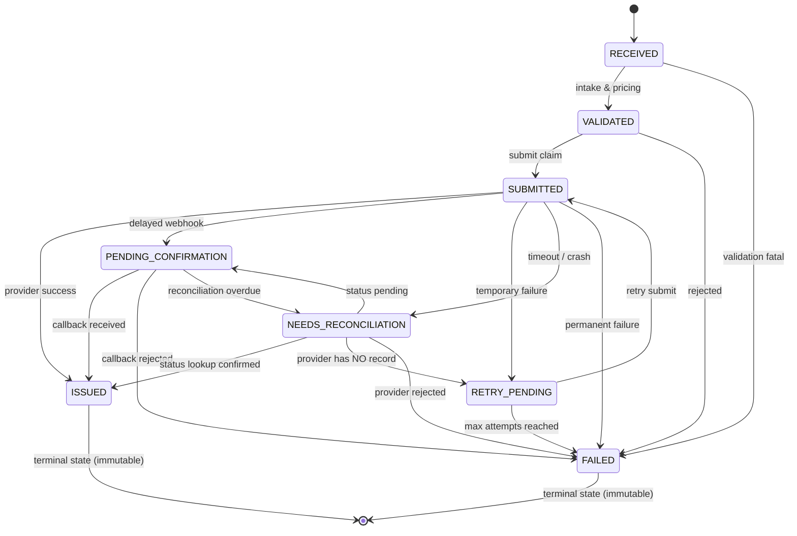
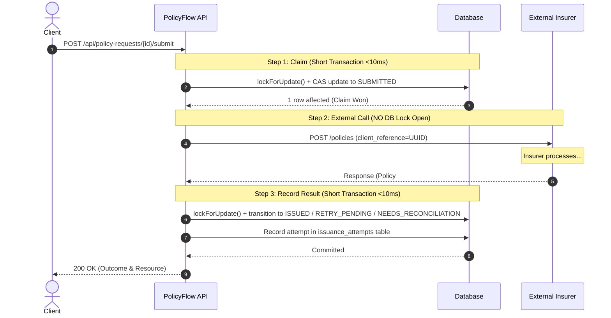

# PolicyFlow

> **Fault-Tolerant Insurance Issuance & Reconciliation Engine**  
> *TrippersShield Campus Placement | Software Engineering Practical Assessment*

[](https://php.net)
[](https://laravel.com)
[-brightgreen.svg)]()
[]()
[]()
[](#12-video-demonstration)

---

## 1. Executive Summary

PolicyFlow is a fault-tolerant policy intake, pricing, and issuance engine designed for travel-insurance distribution networks. External insurer APIs are notoriously unreliable: network connections time out, workers crash mid-flight, and webhooks deliver repeatedly.

**Primary Engineering Objective**: Never issue duplicate policies and never reach an incorrect final state when the same purchase request is retried, timed out, or delivered multiple times.

PolicyFlow implements:
- **Case A (Headline)**: Atomic duplicate intake prevention using database compound unique indexes and SHA-256 canonical payload fingerprinting.
- **Case B (Headline)**: Timeout recovery via status lookup reconciliation without blind re-issuance.
- **Case C**: Idempotent webhook receiver with outbox deduplication and immutable terminal state protection.
- **Case D**: Safe retries after temporary failure preserving the byte-identical original accepted premium snapshot.
- **Pure Integer Pricing**: Hundredth-multiplier decimal-safe integer math in paise (INR) with zero float conversion or `bcmath` reliance.

---

## 2. Quickstart & Local Setup

### Prerequisites
- **PHP** >= 8.2 (Required extensions: `pdo_mysql`, `pdo_sqlite`, `mbstring`, `openssl`, `tokenizer`, `xml`, `ctype`, `json`)
- **Composer** >= 2.0
- **Docker & Docker Compose** (Optional, for zero-config MySQL 8)

Verify your local environment:
```bash
php -v
composer -V
php -m | grep -E "pdo_mysql|pdo_sqlite|mbstring|openssl|tokenizer|xml|ctype|json"
```

---

### Option A: Standard Local Setup (Zero-Config SQLite)

#### macOS / Linux / Git Bash:
```bash
# 1. Clone repository
git clone https://github.com/<your-username>/policyflow-<your-candidate-id>.git
cd policyflow-<your-candidate-id>

# 2. Install PHP dependencies
composer install

# 3. Environment configuration
cp .env.example .env
php artisan key:generate

# 4. Run database migrations (SQLite file auto-created if missing)
touch database/database.sqlite
php artisan migrate

# 5. Start the local server with multi-worker support
PHP_CLI_SERVER_WORKERS=4 php artisan serve --host=127.0.0.1 --port=8000
```

#### Windows PowerShell:
```powershell
# 1. Clone repository
git clone https://github.com/<your-username>/policyflow-<your-candidate-id>.git
cd policyflow-<your-candidate-id>

# 2. Install PHP dependencies
composer install

# 3. Environment configuration
Copy-Item .env.example .env
php artisan key:generate

# 4. Create SQLite database file & migrate
if (!(Test-Path database/database.sqlite)) { New-Item -ItemType File -Force database/database.sqlite }
php artisan migrate

# 5. Start the local server with multi-worker support
$env:PHP_CLI_SERVER_WORKERS="4"; php artisan serve --host=127.0.0.1 --port=8000
```

---

### Option B: Running with MySQL 8 via Docker Compose

To run against a production-grade MySQL 8 instance with true row-level locking (`FOR UPDATE`):

```bash
# 1. Start MySQL 8 container in background (maps to port 3306, or customizable via FORWARD_DB_PORT)
docker compose up -d mysql

# 2. Configure .env for MySQL
# DB_CONNECTION=mysql
# DB_HOST=127.0.0.1
# DB_PORT=3306
# DB_DATABASE=policyflow
# DB_USERNAME=policyflow
# DB_PASSWORD=secret

# 3. Run database migrations on MySQL
php artisan migrate

# 4. Start the server
php artisan serve
```

---

### Option C: Complete Docker-Only Execution (Zero Host Dependencies)
If PHP or Composer are not installed on your host machine:
```bash
# Build & start MySQL and Application via Docker Compose
docker compose up -d

# Run migrations inside the container
docker compose exec app php artisan migrate

# Access the API at http://localhost:8000
```

---

## 3. Automated Testing

The automated test suite runs **160 tests with 698 assertions** and requires **zero setup**:

```bash
# Run entire test suite using in-memory SQLite (Default)
php artisan test
```

### Running Tests Against MySQL 8
```bash
# 1. Copy the testing environment configuration
cp .env.testing.example .env.testing

# 2. Run the test suite against MySQL
php artisan test --env=testing
```

### Verified Test Breakdown
| Test Suite | Tests | Assertions | Focus Area |
|---|---|---|---|
| `PremiumCalculatorTest` | 26 | 80 | 225.00 INR benchmark, 13 hand-computed cases, exact birthday boundaries (17/18, 60/61, 70/71) on `trip_start`, inclusive days, half-up rounding |
| `PolicyStateMachineTest` | 66 | 184 | Full 8×8 (64 transition) matrix, 13 valid transitions, 51 rejected regressions, CAS updates, lost races |
| `PolicyIntakeTest` | 21 | 83 | 201 Created, 200 Safe Replay, 409 Conflict, 422 validations, near-simultaneous race recovery |
| `PolicySubmissionTest` | 10 | 58 | Non-blocking claim, Case B timeout status lookup, Case D retries, lease expiration, double-submit guard |
| `ProviderCallbackTest` | 8 | 46 | Case C duplicate webhooks, outbox deduplication, conflicting policy numbers, terminal state immutability |
| `PolicyQueryTest` | 9 | 174 | Detail with chronological audit trail (`GET /{id}`), pagination bounds, and status/agent filtering |
| `DatabaseSchemaTest` | 5 | 6 | DB unique indexes (agent+client, policy_number, provider_event_id), Eloquent immutability guards |
| `MockInsurerTest` | 8 | 33 | All 6 scenarios (`SUCCESS`, `TEMPORARY_FAILURE`, `TIMEOUT_AFTER_ISSUE`, etc.) and CLI scenario switching |
| `LogPrivacyTest` | 1 | 13 | Structured logs verification; guarantees customer names and DOBs are never leaked to logs |
| `ApiFoundationTest` | 4 | 8 | JSON error structures, 404 Model/Route Not Found, 405 Method Not Allowed |
| **Total** | **160** | **698** | **100% Green / Zero Failures** |

> [!NOTE]
> SQLite serializes writers across the entire database file. True row-level locking (`FOR UPDATE`) only exists on MySQL 8 and PostgreSQL. For this reason, PolicyFlow's concurrency correctness relies on **database unique constraints** and **optimistic Compare-And-Swap (CAS) updates**, rather than database row locks alone.

---

## 4. Architecture & State Machine

### 4.1 State Machine Diagram
PolicyFlow strictly enforces an explicit 8-state machine through backed enum `App\Enums\PolicyStatus`. Regressions (such as `ISSUED -> SUBMITTED`) are strictly rejected by `App\Services\PolicyStateMachine` and throw `InvalidStateTransitionException`.



### 4.2 Non-Blocking 3-Step Submission Protocol
**The Golden Concurrency Rule**: Never hold a database transaction or lock open across an external HTTP call. Doing so holds database connections during network timeouts (10–30s), rapidly starving connection pools.



### 4.3 Background Operations Commands
- **Reconciliation Engine**:
  ```bash
  # Process requests stuck in NEEDS_RECONCILIATION or stale PENDING_CONFIRMATION
  php artisan policy:reconcile --stale-minutes=60 --limit=50
  ```
- **Outbox Event Delivery**:
  ```bash
  # Deliver due mock events from the outbox to the callback receiver
  php artisan mock-insurer:deliver-events
  ```

---

## 5. Duplicate Prevention & Reliability Strategy

### Case A: Duplicate Intake & Near-Simultaneous Race Recovery (Headline)
- **Database Authority**: Compound unique index `uniq_policy_requests_agent_client` on `(agent_id, client_request_id)`.
- **Fast Path**: Look up `agent_id + client_request_id`.
  - Same fingerprint -> HTTP 200 OK with `Idempotent-Replayed: true`.
  - Different fingerprint -> HTTP 409 Conflict with `IDEMPOTENCY_KEY_REUSED_WITH_DIFFERENT_PAYLOAD`.
- **Race Condition Handling**: If two requests arrive at the exact same millisecond, both pass the fast-path lookup. The database unique index allows only one insert. The loser catches `UniqueConstraintViolationException`, re-queries the winner inside a savepoint, compares fingerprints, and returns HTTP 200 or 409. Zero 500 errors, zero duplicate rows.
- **Automated Verification**:
  - PHPUnit: `PolicyIntakeTest::test_near_simultaneous_race_simulation_recovers_safely`
  - Concurrency Simulation: Run `./examples/concurrent_intake.sh` (fires 50 concurrent requests via `xargs -P`).

#### How to Reproduce Case A Manually:
```bash
# 1. Send initial intake request
curl -i -X POST http://127.0.0.1:8000/api/policy-requests \
  -H "Content-Type: application/json" -H "Accept: application/json" \
  -d '{"client_request_id":"DEMO-A-01","agent_id":"AGENT-01","customer_name":"Alice","date_of_birth":"1995-05-10","destination":"INTERNATIONAL","trip_start":"2026-11-01","trip_end":"2026-11-05","plan_code":"PLUS","sum_insured":300000}'
# -> Returns HTTP 201 Created with status "VALIDATED" and premium "225.00"

# 2. Re-send identical request (Safe Idempotent Replay)
curl -i -X POST http://127.0.0.1:8000/api/policy-requests \
  -H "Content-Type: application/json" -H "Accept: application/json" \
  -d '{"client_request_id":"DEMO-A-01","agent_id":"AGENT-01","customer_name":"Alice","date_of_birth":"1995-05-10","destination":"INTERNATIONAL","trip_start":"2026-11-01","trip_end":"2026-11-05","plan_code":"PLUS","sum_insured":300000}'
# -> Returns HTTP 200 OK with header "Idempotent-Replayed: true" and identical UUID

# 3. Send same key with different payload (Conflict Detection)
curl -i -X POST http://127.0.0.1:8000/api/policy-requests \
  -H "Content-Type: application/json" -H "Accept: application/json" \
  -d '{"client_request_id":"DEMO-A-01","agent_id":"AGENT-01","customer_name":"Bob","date_of_birth":"1995-05-10","destination":"INTERNATIONAL","trip_start":"2026-11-01","trip_end":"2026-11-05","plan_code":"PLUS","sum_insured":300000}'
# -> Returns HTTP 409 Conflict {"error_code": "IDEMPOTENCY_KEY_REUSED_WITH_DIFFERENT_PAYLOAD"}
```

---

### Case B: Timeout After Success & Status Lookup Reconciliation (Headline)
- **The Hazard**: The insurer creates the policy internally, but network drops before the HTTP response returns. Blind re-issuance would create a duplicate policy and double-bill.
- **The Solution**: On timeout, PolicyFlow transitions state to `NEEDS_RECONCILIATION` and immediately queries the provider's status lookup endpoint keyed by our client UUID (`GET /policies/{client_reference}`).
  - If provider confirms policy was issued -> safely retrieves policy number and transitions to `ISSUED`.
  - If provider confirms `NOT_FOUND` -> safely transitions to `RETRY_PENDING` (safe to retry because provider has no record).
- **Automated Verification**: `PolicySubmissionTest::test_case_b_timeout_after_issue_inline_reconciliation_resolves_to_issued`.

#### How to Reproduce Case B Manually:
```bash
# 1. Create a policy configured with TIMEOUT_AFTER_ISSUE
INTAKE=$(curl -s -X POST http://127.0.0.1:8000/api/policy-requests \
  -H "Content-Type: application/json" -H "Accept: application/json" \
  -d '{"client_request_id":"DEMO-B-01","agent_id":"AGENT-01","customer_name":"Charlie","date_of_birth":"1990-01-01","destination":"DOMESTIC","trip_start":"2026-12-01","trip_end":"2026-12-05","plan_code":"BASIC","sum_insured":100000,"mock_scenario":"TIMEOUT_AFTER_ISSUE"}')
REQ_ID=$(echo $INTAKE | grep -o '"id":"[^"]*' | cut -d'"' -f4)

# 2. Submit policy request (Provider call times out; inline reconciliation resolves it)
curl -i -X POST http://127.0.0.1:8000/api/policy-requests/${REQ_ID}/submit -H "Accept: application/json"
# -> Returns HTTP 200 OK with status "ISSUED", policy_number populated, and outcome "RECONCILED_ISSUED"
```

---

### Case C: Idempotent Callbacks & Outbox Deduplication
- **Unique Event Store**: Table `provider_events` with unique index on `(provider, provider_event_id)`.
- **Duplicate Callback Delivery**: If the insurer delivers the same webhook 2 or 3 times, the unique constraint catches the duplicate, increments `received_count` atomically, and returns HTTP 200 `{"result": "duplicate"}`.
- **Immutable Terminal State**: Late callbacks arriving after `ISSUED` can never overwrite `policy_number` or state. Conflicting policy numbers log a high-priority anomaly and are stored as `CONFLICT_IGNORED`.
- **Automated Verification**: `ProviderCallbackTest::test_duplicate_callback_delivery_returns_duplicate_and_increments_count`.

#### How to Reproduce Case C Manually:
```bash
# Deliver webhook event 1st time
curl -i -X POST http://127.0.0.1:8000/api/mock-insurer/callback \
  -H "Content-Type: application/json" -H "Accept: application/json" \
  -d "{\"event_id\":\"evt_001\",\"event_type\":\"POLICY_ISSUED\",\"provider_reference\":\"PRV-01\",\"client_reference\":\"${REQ_ID}\",\"policy_number\":\"POL-01\",\"occurred_at\":\"2026-11-10T10:00:00Z\"}"
# -> Returns HTTP 200 {"result": "applied", "request_status": "ISSUED"}

# Deliver identical webhook event 2nd time
curl -i -X POST http://127.0.0.1:8000/api/mock-insurer/callback \
  -H "Content-Type: application/json" -H "Accept: application/json" \
  -d "{\"event_id\":\"evt_001\",\"event_type\":\"POLICY_ISSUED\",\"provider_reference\":\"PRV-01\",\"client_reference\":\"${REQ_ID}\",\"policy_number\":\"POL-01\",\"occurred_at\":\"2026-11-10T10:00:00Z\"}"
# -> Returns HTTP 200 {"result": "duplicate", "request_status": "ISSUED"}
```

---

### Case D: Safe Retry After Temporary Failure
- **State Separation**: Retriable failures transition to `RETRY_PENDING` rather than terminal `FAILED`.
- **Immutable Snapshot**: The accepted premium, currency, travel days, and breakdown are snapshotted at intake. Subsequent retries reuse the exact original snapshot; an Eloquent model guard strictly throws an exception if an update is attempted on snapshot fields.
- **Automated Verification**: `PolicySubmissionTest::test_case_d_retry_after_temporary_failure_preserves_immutable_premium`.

---

## 6. Deterministic Decimal-Safe Pricing

Formula:
$$\text{premium} = \text{base\_daily\_rate} \times \text{travel\_days} \times \text{age\_multiplier} \times \text{destination\_multiplier} \times \text{coverage\_multiplier}$$

### Integer Arithmetic Rules
- Money is represented in **paise** (integers, 1 INR = 100 paise).
- Multipliers are represented as integers in hundredths:
  - Base Daily Rate: `BASIC = 12`, `PLUS = 20`, `PREMIUM = 30` INR
  - Age on `trip_start`: 0–17: `110`, 18–60: `100`, 61–70: `150`, 71+: `200`
  - Destination: `DOMESTIC = 100`, `INTERNATIONAL = 180`
  - Coverage: 100,000: `100`, 300,000: `125`, 500,000: `150`
- Calculation Formula:
  $$\text{numerator} = \text{rate} \times \text{days} \times a \times d \times c$$
  $$\text{premium\_paise} = \text{intdiv}(\text{numerator} + 5000, 10000) \quad \text{(half-up rounding)}$$

### Benchmark Verification (Assessment Example)
- Payload: `AGT-2026-0001`, `AGENT-17`, DOB `1998-04-10`, `INTERNATIONAL`, `2026-11-10` to `2026-11-14`, `PLUS`, `300000`
- Variables: Rate = 20, Days = 5, Age = 28 (100), Destination = 180, Coverage = 125
- Computation: $20 \times 5 \times 100 \times 180 \times 125 = 225,000,000$
- Half-up rounding: $\text{intdiv}(225,000,000 + 5000, 10000) = 22,500\text{ paise} \rightarrow \mathbf{225.00}\text{ INR}$
- Formatted string `"225.00"` is built via integer division and modulo (`sprintf('%d.%02d', intdiv(paise, 100), paise % 100)`), never `number_format` on a float.
- Age is calculated using calendar `DateTimeImmutable::diff()->y`, avoiding Carbon 3 floating point `diffInYears()`.

---

## 7. API Reference

All routes are prefixed with `/api` and strictly return JSON.

### Summary Table
| Method | Endpoint | Purpose | Success Code |
|---|---|---|---|
| `POST` | `/api/policy-requests` | Intake new request or safely return replayed request | `201` / `200` |
| `GET` | `/api/policy-requests/{id}` | Detail view with audit trail and attempt history | `200` |
| `POST` | `/api/policy-requests/{id}/submit` | Claim and execute policy issuance | `200` |
| `GET` | `/api/policy-requests` | List requests with status filtering & pagination | `200` |
| `POST` | `/api/mock-insurer/callback` | Inbound insurer webhook receiver | `200` |
| `POST` | `/api/mock-insurer/events/flush` | Flush simulated delayed mock events (dev-only) | `200` |

---

### 7.1 POST `/api/policy-requests` (Intake)

#### Request Fields
| Field | Type | Rules | Description |
|---|---|---|---|
| `client_request_id` | string | required, max:128 | Unique client reference per agent |
| `agent_id` | string | required, max:64 | Identifier of the issuing agent |
| `customer_name` | string | required, max:255 | Full name of the insured customer |
| `date_of_birth` | date (`Y-m-d`) | required, date_format:Y-m-d, before_or_equal:trip_start | Customer date of birth |
| `destination` | string | required, in:DOMESTIC,INTERNATIONAL | Travel destination zone |
| `trip_start` | date (`Y-m-d`) | required, date_format:Y-m-d | Start date of travel |
| `trip_end` | date (`Y-m-d`) | required, date_format:Y-m-d, after_or_equal:trip_start | End date of travel (inclusive) |
| `plan_code` | string | required, in:BASIC,PLUS,PREMIUM | Insurance plan package |
| `sum_insured` | integer | required, in:100000,300000,500000 | Coverage amount in INR |
| `mock_scenario` | string | optional, in:SUCCESS,TEMPORARY_FAILURE,... | Dev-only scenario override |

#### Request Body
```json
{
  "client_request_id": "AGT-2026-0001",
  "agent_id": "AGENT-17",
  "customer_name": "Sample Customer",
  "date_of_birth": "1998-04-10",
  "destination": "INTERNATIONAL",
  "trip_start": "2026-11-10",
  "trip_end": "2026-11-14",
  "plan_code": "PLUS",
  "sum_insured": 300000
}
```

#### Response: New Request (HTTP 201 Created)
```json
{
  "id": "9d9e4a3b-1234-4567-89ab-cdef01234567",
  "client_request_id": "AGT-2026-0001",
  "agent_id": "AGENT-17",
  "customer_name": "Sample Customer",
  "date_of_birth": "1998-04-10",
  "destination": "INTERNATIONAL",
  "trip_start": "2026-11-10",
  "trip_end": "2026-11-14",
  "plan_code": "PLUS",
  "sum_insured": 300000,
  "travel_days": 5,
  "status": "VALIDATED",
  "premium": "225.00",
  "premium_currency": "INR",
  "premium_breakdown": {
    "base_daily_rate": 20,
    "travel_days": 5,
    "age": 28,
    "age_multiplier": 100,
    "destination_multiplier": 180,
    "coverage_multiplier": 125,
    "pricing_version": "v1.0"
  },
  "provider_reference": null,
  "policy_number": null,
  "attempt_count": 0,
  "last_error_code": null,
  "last_error_message": null,
  "issued_at": null,
  "created_at": "2026-10-23T15:30:00Z",
  "updated_at": "2026-10-23T15:30:00Z"
}
```

#### Response: Repeated Submission (HTTP 200 OK)
Returns the identical JSON body with response header:
`Idempotent-Replayed: true`

#### Response: Payload Mismatch (HTTP 409 Conflict)
```json
{
  "message": "Idempotency key 'AGT-2026-0001' was previously used with a different request payload.",
  "error_code": "IDEMPOTENCY_KEY_REUSED_WITH_DIFFERENT_PAYLOAD"
}
```

#### Response: Validation Error (HTTP 422 Unprocessable Entity)
```json
{
  "message": "The plan code must be one of: BASIC, PLUS, PREMIUM. (and 1 more error)",
  "errors": {
    "plan_code": [
      "The plan code must be one of: BASIC, PLUS, PREMIUM."
    ],
    "trip_end": [
      "trip_end must be on or after trip_start."
    ]
  }
}
```

---

### 7.2 POST `/api/policy-requests/{id}/submit` (Issuance)

#### Response: Successfully Issued (HTTP 200 OK)
```json
{
  "id": "9d9e4a3b-1234-4567-89ab-cdef01234567",
  "status": "ISSUED",
  "policy_number": "POL-9A8B7C6D5E",
  "provider_reference": "PRV-MOCK-123456",
  "attempt_count": 1,
  "issued_at": "2026-10-23T15:35:00Z",
  "submission": {
    "outcome": "ISSUED",
    "provider_called": true
  }
}
```

#### Response: Repeated Submit (HTTP 200 OK - Safe No-Op)
```json
{
  "id": "9d9e4a3b-1234-4567-89ab-cdef01234567",
  "status": "ISSUED",
  "policy_number": "POL-9A8B7C6D5E",
  "submission": {
    "outcome": "ALREADY_ISSUED",
    "provider_called": false
  }
}
```

---

### 7.3 GET `/api/policy-requests/{id}` (Detail & Audit Trail)
Single resources are flat (unwrapped). Detail view includes `audit_trail` (oldest first) and `attempts`:
```json
{
  "id": "9d9e4a3b-1234-4567-89ab-cdef01234567",
  "client_request_id": "AGT-2026-0001",
  "status": "ISSUED",
  "premium": "225.00",
  "policy_number": "POL-9A8B7C6D5E",
  "audit_trail": [
    {
      "from_status": null,
      "to_status": "RECEIVED",
      "reason": "Initial request intake",
      "source": "API",
      "context": null,
      "created_at": "2026-10-23T15:30:00Z"
    },
    {
      "from_status": "RECEIVED",
      "to_status": "VALIDATED",
      "reason": "Intake validation and pricing snapshot complete",
      "source": "API",
      "context": null,
      "created_at": "2026-10-23T15:30:00Z"
    },
    {
      "from_status": "VALIDATED",
      "to_status": "SUBMITTED",
      "reason": "Claimed for issuance attempt 1",
      "source": "SUBMIT",
      "context": {"attempt": 1},
      "created_at": "2026-10-23T15:35:00Z"
    },
    {
      "from_status": "SUBMITTED",
      "to_status": "ISSUED",
      "reason": "Policy successfully issued by provider",
      "source": "SUBMIT",
      "context": null,
      "created_at": "2026-10-23T15:35:01Z"
    }
  ],
  "attempts": [
    {
      "id": 1,
      "type": "ISSUE",
      "sequence": 1,
      "outcome": "ISSUED",
      "http_status": 200,
      "duration_ms": 142
    }
  ]
}
```

#### Response: Unknown ID (HTTP 404 Not Found)
```json
{
  "message": "The requested policy request was not found.",
  "error_code": "REQUEST_NOT_FOUND"
}
```

---

### 7.4 GET `/api/policy-requests` (List & Filtering)

#### Query Parameters
| Parameter | Type | Default | Description |
|---|---|---|---|
| `status` | string | optional | Filter by `PolicyStatus` enum value (e.g. `ISSUED`, `VALIDATED`) |
| `agent_id` | string | optional | Filter by agent identifier (e.g. `AGENT-17`) |
| `per_page` | integer | `15` | Items per page (min: 1, max: 100) |
| `page` | integer | `1` | Page number |

Ordered by: `created_at desc, id desc`. Omits `audit_trail` and `attempts` for list efficiency.

#### Example Request
```bash
curl -s "http://127.0.0.1:8000/api/policy-requests?status=ISSUED&per_page=15&page=1"
```

#### Response (HTTP 200 OK - Standard Laravel Paginator)
```json
{
  "data": [
    {
      "id": "9d9e4a3b-1234-4567-89ab-cdef01234567",
      "client_request_id": "AGT-2026-0001",
      "agent_id": "AGENT-17",
      "customer_name": "Sample Customer",
      "date_of_birth": "1998-04-10",
      "destination": "INTERNATIONAL",
      "trip_start": "2026-11-10",
      "trip_end": "2026-11-14",
      "plan_code": "PLUS",
      "sum_insured": 300000,
      "travel_days": 5,
      "status": "ISSUED",
      "premium": "225.00",
      "premium_currency": "INR",
      "provider_reference": "PRV-MOCK-123456",
      "policy_number": "POL-9A8B7C6D5E",
      "attempt_count": 1,
      "created_at": "2026-10-23T15:30:00Z",
      "updated_at": "2026-10-23T15:35:01Z"
    }
  ],
  "links": {
    "first": "http://127.0.0.1:8000/api/policy-requests?page=1",
    "last": "http://127.0.0.1:8000/api/policy-requests?page=1",
    "prev": null,
    "next": null
  },
  "meta": {
    "current_page": 1,
    "from": 1,
    "last_page": 1,
    "per_page": 15,
    "to": 1,
    "total": 1
  }
}
```

---

### 7.5 POST `/api/mock-insurer/callback` (Webhook Receiver)

#### Inbound Payload
```json
{
  "event_id": "evt_01J98ABCDEF1234567890",
  "event_type": "POLICY_ISSUED",
  "provider_reference": "PRV-MOCK-123456",
  "client_reference": "9d9e4a3b-1234-4567-89ab-cdef01234567",
  "policy_number": "POL-9A8B7C6D5E",
  "occurred_at": "2026-11-10T10:00:00Z"
}
```

#### Response: First Delivery (HTTP 200 OK)
```json
{
  "result": "applied",
  "event_id": "evt_01J98ABCDEF1234567890",
  "request_status": "ISSUED"
}
```

#### Response: Duplicate Delivery (HTTP 200 OK)
```json
{
  "result": "duplicate",
  "event_id": "evt_01J98ABCDEF1234567890",
  "request_status": "ISSUED"
}
```

---

## 8. Mock Insurer & Live Interview Scenarios

The mock insurer service runs in-process (`App\Mock\Insurer\MockInsurerService`) behind the `InsurerGateway` interface.

### Supported Scenarios
| Scenario | Mock Behavior | PolicyFlow Handling |
|---|---|---|
| `SUCCESS` *(default)* | Returns `policy_number` and `provider_reference` | -> `ISSUED` |
| `TEMPORARY_FAILURE` | Retriable 503 error on first N attempts, then succeeds | -> `RETRY_PENDING`, retry succeeds |
| `TIMEOUT_AFTER_ISSUE` | Creates policy in DB, then throws timeout exception | Status lookup resolves to `ISSUED` without re-issue |
| `DELAYED_CALLBACK` | Returns `PENDING`, queues outbox event | -> `PENDING_CONFIRMATION`, flush transitions to `ISSUED` |
| `DUPLICATE_CALLBACK` | Returns `PENDING`, queues identical event 3 times | 1 applied, 2 safely ignored as duplicates |
| `PERMANENT_FAILURE` | Non-retriable 400 rejection | -> `FAILED` |

### Changing Scenarios Live During the Interview
You can change the scenario for any policy request live using the CLI artisan command:
```bash
php artisan mock-insurer:set-scenario {REQUEST_UUID} TIMEOUT_AFTER_ISSUE
```
Or pass the optional `mock_scenario` parameter directly during intake:
```json
{
  "client_request_id": "AGT-LIVE-001",
  "mock_scenario": "TIMEOUT_AFTER_ISSUE",
  ...
}
```

---

## 9. Requirements Traceability Matrix

| Spec Section | Requirement | Implementation File | Verification Test |
|---|---|---|---|
| **3.1** | Policy Request Intake API & Idempotency | `PolicyRequestIntakeService.php` | `PolicyIntakeTest.php` |
| **3.2** | Deterministic Integer Pricing & Snapshot | `PremiumCalculator.php` | `PremiumCalculatorTest.php` |
| **3.3** | Explicit State Machine & Audit Trail | `PolicyStateMachine.php` | `PolicyStateMachineTest.php` |
| **3.4 (1)** | Case A: Duplicate Intake (Near-simultaneous) | `PolicyRequestRepository.php` | `PolicyIntakeTest.php`, `concurrent_intake.sh` |
| **3.4 (2)** | Case B: Timeout After Issue & Reconciliation | `SubmissionService.php`, `ReconciliationService.php` | `PolicySubmissionTest.php` |
| **3.4 (3)** | Case C: Duplicate Webhook Callbacks | `ProviderCallbackService.php` | `ProviderCallbackTest.php` |
| **3.4 (4)** | Case D: Retries After Temporary Failure | `SubmissionService.php` | `PolicySubmissionTest.php` |
| **4.1–4.5** | REST API Contract & Resource Formats | `PolicyRequestController.php`, `PolicyRequestResource.php` | `PolicyQueryTest.php`, `ApiFoundationTest.php` |
| **5.0** | Mock Insurer Engine & Live Switching | `MockInsurerService.php`, `SetMockScenarioCommand.php` | `MockInsurerTest.php` |
| **6.0** | Database Schema & Unique Constraints | `2026_10_23_000001_create_policy_requests_table.php` | `DatabaseSchemaTest.php` |
| **7.5** | PII Privacy in Logging | `PolicyRequestIntakeService.php`, `SubmissionService.php` | `LogPrivacyTest.php` |

---

## 10. Assumptions & Design Decisions

1. **Intake Persists as `VALIDATED`**: The intake endpoint performs both payload validation and deterministic pricing snapshot calculation in a single atomic database transaction. Persisting an unpriced or unvalidated request adds no business value; a persisted request is therefore immediately `VALIDATED`.
2. **HTTP 409 on Key Reuse with Different Payload**: If an agent re-submits an existing `client_request_id` with modified customer or coverage data, PolicyFlow rejects it with HTTP 409 `IDEMPOTENCY_KEY_REUSED_WITH_DIFFERENT_PAYLOAD`. Silently accepting or re-pricing violates idempotency safety.
3. **`RETRY_PENDING` State Addition**: `FAILED` is terminal. When an insurer API returns a temporary failure (e.g. 503), the request is safe to retry. Adding `RETRY_PENDING` provides explicit operational visibility without corrupting the meaning of `FAILED`.
4. **In-Process Mock Insurer**: `php artisan serve` is single-threaded. Making external HTTP calls to self-endpoints would cause immediate deadlocks. The in-process mock behind `InsurerGateway` provides high fidelity while running safely in single-threaded environments.
5. **Age Computed on `trip_start`**: Per insurance domain standards, policy risk is evaluated at the effective start of the policy. If a customer turns 18 during the trip, their policy is priced according to their age on `trip_start`.
6. **No Future-Date Validation Added**: The specification explicitly forbids adding validation rules beyond the spec (such as requiring dates in the future) that could reject legitimate inputs from automated test fixtures.

---

## 11. Known Limitations & Production Roadmap

1. **HMAC Webhook Signatures**: In production, the `/api/mock-insurer/callback` endpoint would be guarded with an HMAC SHA-256 signature middleware (`X-Signature`) using a shared secret between distributor and insurer.
2. **Asynchronous Queues with Backoff**: High-throughput issuance would dispatch a `SubmitPolicyJob` to Redis/Amazon SQS with exponential backoff (e.g. 5s, 30s, 120s) and dead-letter queue routing for failed jobs.
3. **Customer PII Encryption**: To comply with GDPR/DPDP, customer personal data (`customer_name`, `date_of_birth`) should be encrypted at rest in the database using Laravel's encrypted model casts (`AES-256-GCM`).
4. **Transactional Outbox Pattern**: If emitting external domain events (e.g. notifying agents or issuing certificates), an outbox table within the local transaction guarantees zero event loss if the message broker is temporarily offline.
5. **Observability**: Integrate OpenTelemetry distributed tracing to trace requests end-to-end across distributor and insurer APIs.

---

## 12. Video Demonstration

A 3–5 minute screen recording walking through project setup, intake, idempotency, timeout reconciliation, and test execution is available at:

> **Recording URL**: `[INSERT_YOUR_DEMO_VIDEO_LINK_HERE]`  
> *(Reference: Complete minute-by-minute transcript and talking points in [`docs/DEMO_SCRIPT.md`](docs/DEMO_SCRIPT.md))*

---

## 13. Pre-Submission Checklist

- [x] All 5 mandatory API endpoints implemented and strictly output JSON.
- [x] Pure integer pricing in paise with half-up rounding and snapshot immutability.
- [x] Compound unique index on `(agent_id, client_request_id)` for duplicate intake safety.
- [x] Unique indexes on `policy_number`, `provider_reference`, and `(provider, provider_event_id)`.
- [x] All state changes driven through `PolicyStateMachine` with optimistic CAS updates.
- [x] Non-blocking provider calls (no DB lock held across HTTP calls).
- [x] Case A (intake race), Case B (timeout lookup), Case C (duplicate webhooks), Case D (retries) verified.
- [x] 160 automated tests passing (100% green on SQLite in-memory and MySQL 8).
- [x] Zero customer PII leaked to logs (`LogPrivacyTest`).
- [x] Truthful `AI_USAGE.md` included.
- [x] Code style formatted with Laravel Pint (0 violations across 87 files).
- [x] Confidential interview notes generated in git-ignored `INTERVIEW_PREP.local.md`.
