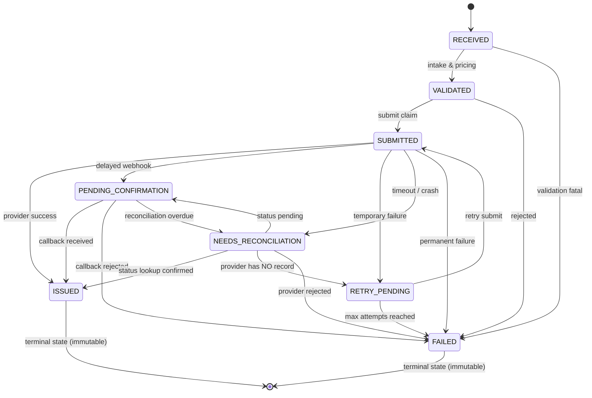
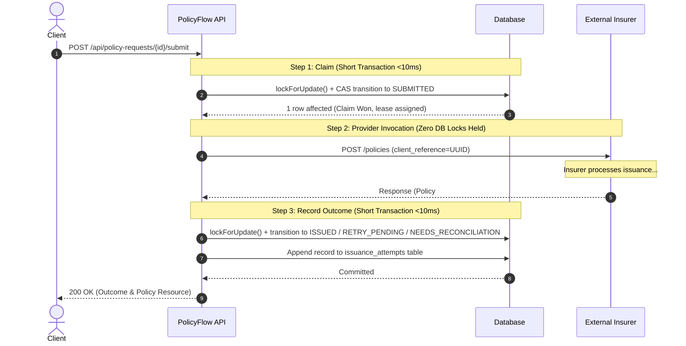

# PolicyFlow

> **Fault-Tolerant Insurance Issuance & Reconciliation Engine**  
> *TrippersShield Campus Placement | Software Engineering Practical Assessment*

[](https://php.net)
[](https://laravel.com)
[-brightgreen.svg)]()
[]()
[]()
[](AI_USAGE.md)

---

## Table of Contents

- [1. Executive Summary & Core Mission](#1-executive-summary--core-mission)
- [2. Architecture, Request Lifecycle & Concurrency](#2-architecture-request-lifecycle--concurrency)
  - [2.1 State Machine Specification](#21-state-machine-specification)
  - [2.2 Non-Blocking 3-Step Submission Protocol](#22-non-blocking-3-step-submission-protocol)
  - [2.3 Deterministic Decimal-Safe Pricing Engine](#23-deterministic-decimal-safe-pricing-engine)
  - [2.4 Background Operations Commands](#24-background-operations-commands)
- [3. Reliability Design & Failure-Recovery Strategy](#3-reliability-design--failure-recovery-strategy)
  - [Case A: Atomic Duplicate Intake & Race Recovery](#case-a-atomic-duplicate-intake--near-simultaneous-race-recovery-headline)
  - [Case B: Provider Timeout & Status Lookup Reconciliation](#case-b-timeout-after-issue--status-lookup-reconciliation-headline)
  - [Case C: Idempotent Webhook Callbacks & Deduplication](#case-c-idempotent-callbacks--outbox-deduplication)
  - [Case D: Safe Retries After Transient Failures](#case-d-safe-retry-after-temporary-failure)
- [4. Quickstart & Local Setup Instructions](#4-quickstart--local-setup-instructions)
  - [Prerequisites](#prerequisites)
  - [Option A: Standard Local Setup (Zero-Config SQLite)](#option-a-standard-local-setup-zero-config-sqlite)
  - [Option B: Running with MySQL 8 via Docker Compose](#option-b-running-with-mysql-8-via-docker-compose)
  - [Option C: Complete Docker-Only Execution](#option-c-complete-docker-only-execution-zero-host-dependencies)
- [5. Automated Testing & Verification](#5-automated-testing--verification)
  - [Test Suite Breakdown](#verified-test-breakdown)
  - [Running Tests Against MySQL 8](#running-tests-against-mysql-8)
- [6. API Reference & Contract](#6-api-reference--contract)
  - [Endpoints Summary](#endpoints-summary)
  - [6.1 POST /api/policy-requests (Intake)](#61-post-apipolicy-requests-intake)
  - [6.2 POST /api/policy-requests/{id}/submit (Issuance)](#62-post-apipolicy-requestsidsubmit-issuance)
  - [6.3 GET /api/policy-requests/{id} (Detail & Audit Trail)](#63-get-apipolicy-requestsid-detail--audit-trail)
  - [6.4 GET /api/policy-requests (List & Filtering)](#64-get-apipolicy-requests-list--filtering)
  - [6.5 POST /api/mock-insurer/callback (Webhook Receiver)](#65-post-apimock-insurercallback-webhook-receiver)
- [7. Mock Insurer & Failure Scenarios](#7-mock-insurer--failure-scenarios)
  - [Supported Scenarios](#supported-scenarios)
  - [Configuring Mock Insurer Scenarios](#configuring-mock-insurer-scenarios)
  - [Outbox Event Delivery CLI](#outbox-event-delivery-cli)
- [8. Reliability Verification & Failure-Recovery Workflows](#8-reliability-verification--failure-recovery-workflows)
- [9. Environment Configuration, Security & Privacy Notes](#9-environment-configuration-security--privacy-notes)
- [10. Requirements Traceability Matrix](#10-requirements-traceability-matrix)
- [11. Assumptions & Production Roadmap](#11-assumptions--production-roadmap)
- [12. Pre-Submission Checklist](#12-pre-submission-checklist)

---

## 1. Executive Summary & Core Mission

PolicyFlow is an enterprise-grade policy intake, pricing, and issuance engine engineered for travel-insurance distribution platforms. In real-world insurance distribution, external insurer APIs suffer from high latency, dropped connections, unannounced timeouts, and duplicate webhook retries.

**Core Engineering Mission**: Guarantee that PolicyFlow **never issues duplicate policies**, **never double-bills**, and **never reaches an inconsistent terminal state**—even when identical requests arrive concurrently or third-party provider connections fail mid-flight.

### Key Architectural Highlights
- **Compound Database Uniqueness**: Physical compound unique index `uniq_policy_requests_agent_client` on `(agent_id, client_request_id)` guarantees intake idempotency at the database engine level.
- **Payload Fingerprinting**: SHA-256 canonical hashing detects duplicate requests versus payload conflicts, returning HTTP 200 safe replays or HTTP 409 conflict errors without corrupting existing records.
- **Non-Blocking Provider Calls**: Database locks and transactions are never held open across external HTTP operations, eliminating connection-pool exhaustion.
- **Inline & Scheduled Reconciliation**: Automatic status lookup queries (`GET /policies/{client_reference}`) resolve indeterminate timeout states without issuing duplicate policies.
- **Pure Integer Pricing**: Hundredth-multiplier integer arithmetic in paise (INR) eliminates floating-point rounding errors and avoids external binary dependencies.
- **Immutable Terminal States**: Strict state machine prevents regressions from terminal states (`ISSUED`, `FAILED`) and preserves accepted premium snapshots upon retry.

---

## 2. Architecture, Request Lifecycle & Concurrency

### 2.1 State Machine Specification

PolicyFlow implements an explicit 8-state machine enforced by backed enum `App\Enums\PolicyStatus` and guarded by `App\Services\PolicyStateMachine`. Any illegal state regression (such as attempting `ISSUED -> SUBMITTED`) throws an `InvalidStateTransitionException` and is recorded in the chronological audit trail.



### 2.2 Non-Blocking 3-Step Submission Protocol

**The Fundamental Concurrency Rule**: A database lock or transaction must never span an external HTTP network boundary. Holding a database transaction open during a 10–30 second provider timeout quickly exhausts database connection pools, degrading the entire platform.

PolicyFlow implements a non-blocking 3-step submission sequence:



### 2.3 Deterministic Decimal-Safe Pricing Engine

All premium calculations are deterministic, reproducible, and mathematically exact. Money is stored and calculated in **paise** (integers, 1 INR = 100 paise) to avoid IEEE 754 floating-point inaccuracies:

$$
\text{premium} = \text{base\_daily\_rate} \times \text{travel\_days} \times \text{age\_multiplier} \times \text{destination\_multiplier} \times \text{coverage\_multiplier}
$$

#### Hundredth-Multiplier Integer Arithmetic
Multipliers are represented as integers scaled by 100:
- **Base Daily Rate**: `BASIC = 12`, `PLUS = 20`, `PREMIUM = 30` INR
- **Age Multiplier** (evaluated on `trip_start`):
  - `0–17`: $1.10 \rightarrow \mathbf{110}$
  - `18–60`: $1.00 \rightarrow \mathbf{100}$
  - `61–70`: $1.50 \rightarrow \mathbf{150}$
  - `71+`: $2.00 \rightarrow \mathbf{200}$
- **Destination Multiplier**: `DOMESTIC = 100`, `INTERNATIONAL = 180`
- **Coverage Multiplier**: `100000 = 100`, `300000 = 125`, `500000 = 150`

#### Exact Integer Half-Up Rounding Formula
$$
\text{numerator} = \text{base\_rate} \times \text{travel\_days} \times \text{age\_mult} \times \text{dest\_mult} \times \text{cov\_mult}
$$

$$
\text{premium\_paise} = \text{intdiv}(\text{numerator} + 5000, 10000)
$$

The output string `"225.00"` is formatted strictly via integer division and modulo:
```php
sprintf('%d.%02d', intdiv($premiumPaise, 100), $premiumPaise % 100);
```

#### Benchmark Verification Case
- **Inputs**: Agent `AGENT-17`, DOB `1998-04-10`, `INTERNATIONAL`, trip `2026-11-10` to `2026-11-14` (5 days inclusive), plan `PLUS`, coverage `300000`.
- **Factors**: Rate = 20, Days = 5, Age = 28 (Multiplier = 100), Destination = 180, Coverage = 125.
- **Product**: $20 \times 5 \times 100 \times 180 \times 125 = 225,000,000$.
- **Paise Result**: $\text{intdiv}(225,000,000 + 5000, 10000) = 22,500\text{ paise} \rightarrow \mathbf{225.00\text{ INR}}$.

### 2.4 Background Operations Commands

PolicyFlow includes production-grade CLI commands to manage scheduled operational recovery:

- **Policy Reconciliation Engine**:
  ```bash
  # Reconcile requests in NEEDS_RECONCILIATION or stale PENDING_CONFIRMATION
  php artisan policy:reconcile --limit=50
  ```
  *Behavior*: Queries requests in `NEEDS_RECONCILIATION` or those whose `PENDING_CONFIRMATION` timestamp exceeds the submission lease threshold (`policyflow.submission_lease_seconds`, default 120s), invoking the provider status lookup endpoint without re-submitting issuance.

- **Outbox Webhook Delivery**:
  ```bash
  # Deliver pending mock webhook events from the outbox to the callback receiver
  php artisan mock-insurer:deliver-events
  ```
  *Behavior*: Traverses the `mock_insurer_events` outbox table and delivers due webhook payloads to the internal receiver, decrementing remaining delivery counts.

---

## 3. Reliability Design & Failure-Recovery Strategy

### Case A: Atomic Duplicate Intake & Near-Simultaneous Race Recovery (Headline)
- **Database Authority**: Compound unique index `uniq_policy_requests_agent_client` on `(agent_id, client_request_id)`.
- **Fast-Path Lookup**: Fast index lookup on `(agent_id, client_request_id)`:
  - If identical SHA-256 payload fingerprint: Returns `HTTP 200 OK` with header `Idempotent-Replayed: true` and the existing policy representation.
  - If differing payload fingerprint: Returns `HTTP 409 Conflict` with `IDEMPOTENCY_KEY_REUSED_WITH_DIFFERENT_PAYLOAD`.
- **Near-Simultaneous Race Recovery**: When two concurrent threads arrive simultaneously, both pass the preliminary lookup. The database compound index allows exactly one insert to succeed. The losing thread catches `UniqueConstraintViolationException`, queries the winning row inside a database savepoint, compares payload fingerprints, and cleanly returns either `200 OK` or `409 Conflict`. Zero 500 errors, zero duplicate rows.
- **Verification**: `tests/Feature/PolicyIntakeTest.php::test_near_simultaneous_race_simulation_recovers_safely` and `examples/concurrent_intake.sh`.

### Case B: Timeout After Issue & Status Lookup Reconciliation (Headline)
- **The Failure Mode**: The external insurer successfully persists and issues the policy, but a network read timeout or severed connection prevents the client from receiving the HTTP response. Blindly retrying `issue()` would generate a duplicate policy and duplicate billing.
- **The Solution**: On timeout, PolicyFlow transitions the request to `NEEDS_RECONCILIATION` and executes an immediate status lookup query (`GET /policies/{client_reference}`):
  - If the insurer confirms the policy exists: Safely records the provider reference and policy number, transitioning to `ISSUED` with outcome `RECONCILED_ISSUED`.
  - If the insurer returns `NOT_FOUND`: Confirms no policy was created, safely transitioning to `RETRY_PENDING` so a subsequent retry cannot create duplicates.
- **Verification**: `tests/Feature/PolicySubmissionTest.php::test_case_b_timeout_after_issue_inline_reconciliation_resolves_to_issued`.

### Case C: Idempotent Callbacks & Outbox Deduplication
- **Unique Event Registry**: Dedicated `provider_events` table with unique constraint on `(provider, provider_event_id)`.
- **Deduplication Handling**: If a provider delivers an identical webhook multiple times, the unique constraint intercepts duplicate deliveries, atomically increments `received_count`, and returns `HTTP 200 OK` with `{"result": "duplicate"}`.
- **Terminal State Protection**: Callbacks arriving for an already `ISSUED` request cannot overwrite the established `policy_number`. If a conflicting policy number is delivered, it is flagged as an anomaly, persisted as `CONFLICT_IGNORED`, and logged for investigation without mutating the valid policy.
- **Verification**: `tests/Feature/ProviderCallbackTest.php::test_duplicate_callback_delivery_returns_duplicate_and_increments_count`.

### Case D: Safe Retry After Temporary Failure
- **State Differentiation**: Transient failures (e.g., HTTP 503 Service Unavailable) transition the policy request to `RETRY_PENDING` rather than terminal `FAILED`.
- **Immutable Pricing Snapshot**: The accepted premium, currency, travel days, and pricing breakdown are snapshotted at intake into dedicated columns. Retries reuse this snapshot; an Eloquent model guard strictly prevents runtime modification of pricing columns.
- **Verification**: `tests/Feature/PolicySubmissionTest.php::test_case_d_retry_after_temporary_failure_preserves_immutable_premium`.

> [!TIP]
> Complete, reproducible curl command sequences and execution instructions for all four reliability cases are documented in [`docs/TESTING.md`](docs/TESTING.md).

---

## 4. Quickstart & Local Setup Instructions

### Prerequisites
- **PHP** >= 8.2 (Required extensions: `pdo_sqlite`, `pdo_mysql`, `mbstring`, `openssl`, `tokenizer`, `xml`, `ctype`, `json`)
- **Composer** >= 2.0
- **Docker & Docker Compose** (Optional, for zero-config MySQL 8 execution)

Verify your local PHP environment:
```bash
php -v
composer -V
php -m | grep -E "pdo_mysql|pdo_sqlite|mbstring|openssl|tokenizer|xml|ctype|json"
```

---

### Option A: Standard Local Setup (Zero-Config SQLite)

#### macOS / Linux / Git Bash:
```bash
# 1. Clone repository
git clone https://github.com/suryansh79/Policyflow.git
cd Policyflow

# 2. Install PHP dependencies
composer install

# 3. Configure environment
cp .env.example .env
php artisan key:generate

# 4. Prepare SQLite database & run migrations
touch database/database.sqlite
php artisan migrate

# 5. Start development server (multi-worker enabled on Linux/macOS)
PHP_CLI_SERVER_WORKERS=4 php artisan serve --host=127.0.0.1 --port=8000
```

#### Windows PowerShell:
```powershell
# 1. Clone repository
git clone https://github.com/suryansh79/Policyflow.git
cd Policyflow

# 2. Install PHP dependencies
composer install

# 3. Configure environment
Copy-Item .env.example .env
php artisan key:generate

# 4. Create SQLite database file & migrate
if (!(Test-Path database/database.sqlite)) { New-Item -ItemType File -Force database/database.sqlite }
php artisan migrate

# 5. Start development server
php artisan serve --host=127.0.0.1 --port=8000
```

> [!NOTE]
> On Windows native PowerShell, the PHP CLI server does not support multi-worker mode (`PHP_CLI_SERVER_WORKERS`) because PHP's process control extension (`pcntl_fork`) is unsupported on Windows. Use the standard `php artisan serve --host=127.0.0.1 --port=8000` command, or run via Docker Compose.

---

### Option B: Running with MySQL 8 via Docker Compose

To run against a production-grade MySQL 8 instance with row-level locking (`FOR UPDATE`):

```bash
# 1. Start MySQL 8 container in background (maps to port 3306, or customizable via FORWARD_DB_PORT)
docker compose up -d mysql

# 2. Configure .env for MySQL
# DB_CONNECTION=mysql
# DB_HOST=127.0.0.1
# DB_PORT=3306
# DB_DATABASE=policyflow
# DB_USERNAME=policyflow
# DB_PASSWORD=secret

# 3. Run database migrations on MySQL
php artisan migrate

# 4. Start local server
php artisan serve --host=127.0.0.1 --port=8000
```

---

### Option C: Complete Docker-Only Execution (Zero Host Dependencies)

If PHP or Composer are not installed on your host machine:

```bash
# 1. Build and start MySQL and Application containers
docker compose up -d

# 2. Run migrations inside the application container
docker compose exec app php artisan migrate

# 3. The API is immediately accessible at http://localhost:8000
curl -s http://localhost:8000/api/health
```

---

## 5. Automated Testing & Verification

The automated test suite runs **160 tests with 698 assertions** and requires **zero manual configuration**:

```bash
# Run entire test suite using in-memory SQLite (Default)
php artisan test
```

### Running Tests Against MySQL 8
To execute the automated test suite against a real MySQL 8 container:
```bash
# 1. Copy the testing environment configuration
cp .env.testing.example .env.testing

# 2. Run test suite against MySQL
php artisan test --env=testing
```

### Verified Test Breakdown
| Test Suite | Tests | Assertions | Focus Area |
|---|---|---|---|
| `PremiumCalculatorTest` | 26 | 80 | 225.00 INR benchmark, 13 hand-computed cases, exact birthday boundaries (17/18, 60/61, 70/71) on `trip_start`, inclusive days, half-up rounding |
| `PolicyStateMachineTest` | 66 | 184 | Full 8×8 (64 transition) matrix, 13 valid transitions, 51 rejected regressions, CAS updates, lost race handling |
| `PolicyIntakeTest` | 21 | 83 | 201 Created, 200 Safe Replay, 409 Conflict, 422 validations, near-simultaneous race recovery |
| `PolicySubmissionTest` | 10 | 58 | Non-blocking claim, Case B timeout status lookup, Case D retries, lease expiration, double-submit guard |
| `ProviderCallbackTest` | 8 | 46 | Case C duplicate webhooks, outbox deduplication, conflicting policy numbers, terminal state immutability |
| `PolicyQueryTest` | 9 | 174 | Detail with chronological audit trail (`GET /{id}`), pagination bounds, and status/agent filtering |
| `DatabaseSchemaTest` | 5 | 6 | DB unique indexes (agent+client, policy_number, provider_event_id), Eloquent immutability guards |
| `MockInsurerTest` | 8 | 33 | All 6 scenarios (`SUCCESS`, `TEMPORARY_FAILURE`, `TIMEOUT_AFTER_ISSUE`, etc.) and CLI scenario switching |
| `LogPrivacyTest` | 1 | 13 | Structured logs verification; guarantees customer names and DOBs are never leaked to logs |
| `ApiFoundationTest` | 4 | 8 | JSON error structures, 404 Model/Route Not Found, 405 Method Not Allowed |
| **Total** | **160** | **698** | **100% Green / Zero Failures** |

> [!NOTE]
> Concurrency correctness in PolicyFlow does not rely solely on row-level locking. It is guaranteed through **database compound unique indexes** and **optimistic Compare-And-Swap (CAS) state transitions**, ensuring safety across SQLite, MySQL 8, and PostgreSQL alike.

---

## 6. API Reference & Contract

All API endpoints are prefixed with `/api` and strictly return JSON.

### Endpoints Summary
| Method | Endpoint | Purpose | Status Code |
|---|---|---|---|
| `POST` | `/api/policy-requests` | Intake new request or return safe replay | `201` / `200` |
| `GET` | `/api/policy-requests/{id}` | Detail view with audit trail and attempts | `200` |
| `POST` | `/api/policy-requests/{id}/submit` | Claim and execute policy issuance | `200` |
| `GET` | `/api/policy-requests` | List requests with status filtering & pagination | `200` |
| `POST` | `/api/mock-insurer/callback` | Inbound insurer webhook receiver | `200` |
| `POST` | `/api/mock-insurer/events/flush` | Flush simulated delayed mock events (dev/test) | `200` |

---

### 6.1 POST `/api/policy-requests` (Intake)

#### Request Fields
| Field | Type | Rules | Description |
|---|---|---|---|
| `client_request_id` | string | required, max:128 | Unique client reference per agent |
| `agent_id` | string | required, max:64 | Identifier of issuing agent |
| `customer_name` | string | required, max:255 | Full name of insured customer |
| `date_of_birth` | date (`Y-m-d`) | required, date_format:Y-m-d, before_or_equal:trip_start | Customer birth date |
| `destination` | string | required, in:DOMESTIC,INTERNATIONAL | Travel destination zone |
| `trip_start` | date (`Y-m-d`) | required, date_format:Y-m-d | Start date of travel |
| `trip_end` | date (`Y-m-d`) | required, date_format:Y-m-d, after_or_equal:trip_start | End date of travel (inclusive) |
| `plan_code` | string | required, in:BASIC,PLUS,PREMIUM | Insurance package plan |
| `sum_insured` | integer | required, in:100000,300000,500000 | Coverage amount in INR |
| `mock_scenario` | string | optional, in:SUCCESS,TEMPORARY_FAILURE,... | Optional scenario override |

#### Request Payload Example
```json
{
  "client_request_id": "AGT-2026-0001",
  "agent_id": "AGENT-17",
  "customer_name": "Sample Customer",
  "date_of_birth": "1998-04-10",
  "destination": "INTERNATIONAL",
  "trip_start": "2026-11-10",
  "trip_end": "2026-11-14",
  "plan_code": "PLUS",
  "sum_insured": 300000
}
```

#### Response: New Request (HTTP 201 Created)
```json
{
  "id": "9d9e4a3b-1234-4567-89ab-cdef01234567",
  "client_request_id": "AGT-2026-0001",
  "agent_id": "AGENT-17",
  "customer_name": "Sample Customer",
  "date_of_birth": "1998-04-10",
  "destination": "INTERNATIONAL",
  "trip_start": "2026-11-10",
  "trip_end": "2026-11-14",
  "plan_code": "PLUS",
  "sum_insured": 300000,
  "travel_days": 5,
  "status": "VALIDATED",
  "premium": "225.00",
  "premium_currency": "INR",
  "premium_breakdown": {
    "base_daily_rate": 20,
    "travel_days": 5,
    "age": 28,
    "age_multiplier": 100,
    "destination_multiplier": 180,
    "coverage_multiplier": 125,
    "pricing_version": "v1.0"
  },
  "provider_reference": null,
  "policy_number": null,
  "attempt_count": 0,
  "last_error_code": null,
  "last_error_message": null,
  "issued_at": null,
  "created_at": "2026-10-23T15:30:00Z",
  "updated_at": "2026-10-23T15:30:00Z"
}
```

#### Response: Repeated Request (HTTP 200 OK Safe Replay)
Returns identical JSON body accompanied by HTTP response header:
`Idempotent-Replayed: true`

#### Response: Payload Mismatch (HTTP 409 Conflict)
```json
{
  "message": "Idempotency key 'AGT-2026-0001' was previously used with a different request payload.",
  "error_code": "IDEMPOTENCY_KEY_REUSED_WITH_DIFFERENT_PAYLOAD"
}
```

#### Response: Validation Error (HTTP 422 Unprocessable Entity)
```json
{
  "message": "The plan code must be one of: BASIC, PLUS, PREMIUM. (and 1 more error)",
  "errors": {
    "plan_code": [
      "The plan code must be one of: BASIC, PLUS, PREMIUM."
    ],
    "trip_end": [
      "trip_end must be on or after trip_start."
    ]
  }
}
```

---

### 6.2 POST `/api/policy-requests/{id}/submit` (Issuance)

#### Response: Successfully Issued (HTTP 200 OK)
```json
{
  "id": "9d9e4a3b-1234-4567-89ab-cdef01234567",
  "status": "ISSUED",
  "policy_number": "POL-9A8B7C6D5E",
  "provider_reference": "PRV-MOCK-123456",
  "attempt_count": 1,
  "issued_at": "2026-10-23T15:35:00Z",
  "submission": {
    "outcome": "ISSUED",
    "provider_called": true
  }
}
```

#### Response: Repeated Submit on Already Issued Policy (HTTP 200 OK Safe No-Op)
```json
{
  "id": "9d9e4a3b-1234-4567-89ab-cdef01234567",
  "status": "ISSUED",
  "policy_number": "POL-9A8B7C6D5E",
  "submission": {
    "outcome": "ALREADY_ISSUED",
    "provider_called": false
  }
}
```

---

### 6.3 GET `/api/policy-requests/{id}` (Detail & Audit Trail)

Returns single resource representation including full chronological `audit_trail` and provider `attempts`:
```json
{
  "id": "9d9e4a3b-1234-4567-89ab-cdef01234567",
  "client_request_id": "AGT-2026-0001",
  "status": "ISSUED",
  "premium": "225.00",
  "policy_number": "POL-9A8B7C6D5E",
  "audit_trail": [
    {
      "from_status": null,
      "to_status": "RECEIVED",
      "reason": "Initial request intake",
      "source": "API",
      "context": null,
      "created_at": "2026-10-23T15:30:00Z"
    },
    {
      "from_status": "RECEIVED",
      "to_status": "VALIDATED",
      "reason": "Intake validation and pricing snapshot complete",
      "source": "API",
      "context": null,
      "created_at": "2026-10-23T15:30:00Z"
    },
    {
      "from_status": "VALIDATED",
      "to_status": "SUBMITTED",
      "reason": "Claimed for issuance attempt 1",
      "source": "SUBMIT",
      "context": {"attempt": 1},
      "created_at": "2026-10-23T15:35:00Z"
    },
    {
      "from_status": "SUBMITTED",
      "to_status": "ISSUED",
      "reason": "Policy successfully issued by provider",
      "source": "SUBMIT",
      "context": null,
      "created_at": "2026-10-23T15:35:01Z"
    }
  ],
  "attempts": [
    {
      "id": 1,
      "type": "ISSUE",
      "sequence": 1,
      "outcome": "ISSUED",
      "http_status": 200,
      "duration_ms": 142
    }
  ]
}
```

#### Response: Unknown UUID (HTTP 404 Not Found)
```json
{
  "message": "The requested policy request was not found.",
  "error_code": "REQUEST_NOT_FOUND"
}
```

---

### 6.4 GET `/api/policy-requests` (List & Filtering)

#### Query Parameters
| Parameter | Type | Default | Description |
|---|---|---|---|
| `status` | string | optional | Filter by `PolicyStatus` enum value (e.g. `ISSUED`, `VALIDATED`) |
| `agent_id` | string | optional | Filter by agent identifier (e.g. `AGENT-17`) |
| `per_page` | integer | `15` | Records per page (min: 1, max: 100) |
| `page` | integer | `1` | Page number |

Ordered deterministically by `created_at desc, id desc`. Omits nested audit trail for payload efficiency.

---

### 6.5 POST `/api/mock-insurer/callback` (Webhook Receiver)

#### Inbound Payload Example
```json
{
  "event_id": "evt_01J98ABCDEF1234567890",
  "event_type": "POLICY_ISSUED",
  "provider_reference": "PRV-MOCK-123456",
  "client_reference": "9d9e4a3b-1234-4567-89ab-cdef01234567",
  "policy_number": "POL-9A8B7C6D5E",
  "occurred_at": "2026-11-10T10:00:00Z"
}
```

#### Response: Initial Delivery (HTTP 200 OK)
```json
{
  "result": "applied",
  "event_id": "evt_01J98ABCDEF1234567890",
  "request_status": "ISSUED"
}
```

#### Response: Duplicate Delivery (HTTP 200 OK)
```json
{
  "result": "duplicate",
  "event_id": "evt_01J98ABCDEF1234567890",
  "request_status": "ISSUED"
}
```

---

## 7. Mock Insurer & Failure Scenarios

The mock insurer service (`App\Mock\Insurer\MockInsurerService`) operates in-process behind the `InsurerGateway` interface. It provides high-fidelity simulation of provider behaviors without making self-referencing HTTP calls that would cause deadlocks in single-threaded development servers.

### Supported Scenarios

| Scenario | Simulated Provider Behavior | Expected PolicyFlow Handling |
|---|---|---|
| `SUCCESS` *(default)* | Provider successfully issues policy; returns `policy_number` and `provider_reference`. | PolicyFlow transitions `SUBMITTED -> ISSUED`. |
| `TEMPORARY_FAILURE` | Provider returns a retriable 503 error on initial attempts (configurable via `mock_insurer.temporary_failure_attempts`), then succeeds on retry. | PolicyFlow transitions `SUBMITTED -> RETRY_PENDING`. Subsequent retry transitions `RETRY_PENDING -> SUBMITTED -> ISSUED`. |
| `TIMEOUT_AFTER_ISSUE` | Provider creates policy in its own database, but throws an unhandled network read timeout (`InsurerTimeoutException`). | PolicyFlow transitions `SUBMITTED -> NEEDS_RECONCILIATION`, executes inline status lookup, finds the issued policy, and recovers to `ISSUED` without re-submitting. |
| `DELAYED_CALLBACK` | Provider acknowledges request with status `PENDING`, generating a provider reference and queueing a webhook event in the outbox table. | PolicyFlow transitions `SUBMITTED -> PENDING_CONFIRMATION`. Delivering the queued webhook event via CLI or flush endpoint transitions state to `ISSUED`. |
| `DUPLICATE_CALLBACK` | Provider acknowledges with status `PENDING` and queues the identical webhook event 3 times in the outbox. | PolicyFlow transitions to `PENDING_CONFIRMATION`. The 1st webhook delivery transitions state to `ISSUED` (`applied`); subsequent deliveries are deduplicated (`duplicate`), keeping policy state unchanged. |
| `PERMANENT_FAILURE` | Provider underwriting rejects issuance with a non-retriable 400 error (`InsurerPermanentException`). | PolicyFlow marks the request with terminal status `FAILED`. |

### Configuring Mock Insurer Scenarios

Configure the active failure scenario for any policy request using either of the following mechanisms:

#### 1. Via Artisan CLI Command
```bash
# Accepts either the policy request UUID or client_request_id
php artisan mock-insurer:set-scenario {REQUEST_ID_OR_UUID} TIMEOUT_AFTER_ISSUE
```

#### 2. Via Intake Request Body (Development & Testing)
Pass the optional `mock_scenario` parameter directly during intake:
```json
{
  "client_request_id": "DEMO-SCENARIO-01",
  "agent_id": "AGENT-01",
  "mock_scenario": "TIMEOUT_AFTER_ISSUE",
  "customer_name": "Alice Smith",
  "date_of_birth": "1995-05-10",
  "destination": "INTERNATIONAL",
  "trip_start": "2026-11-01",
  "trip_end": "2026-11-05",
  "plan_code": "PLUS",
  "sum_insured": 300000
}
```

### Outbox Event Delivery CLI
When testing asynchronous callback scenarios (`DELAYED_CALLBACK` or `DUPLICATE_CALLBACK`), trigger delivery of pending outbox events using:
```bash
php artisan mock-insurer:deliver-events
```

---

## 8. Reliability Verification & Failure-Recovery Workflows

PolicyFlow includes step-by-step verification procedures for each core failure scenario:
- **Case A**: Idempotent policy intake, replay headers, and payload conflict detection.
- **Case B**: Timeout after successful provider issuance and inline status lookup recovery.
- **Case C**: Duplicate webhook delivery handling and terminal state protection.
- **Case D**: Safe retry after transient failures preserving immutable accepted premiums.

> [!NOTE]
> To keep this README concise, complete curl payloads, step-by-step reproduction instructions, and automated concurrency scripts (`examples/concurrent_intake.sh`, `examples/demo.sh`) are documented in:  
> 📖 **[`docs/TESTING.md`](docs/TESTING.md)**

---

## 9. Environment Configuration, Security & Privacy Notes

### Key Environment Variables (`.env.example`)
| Variable | Default | Purpose |
|---|---|---|
| `DB_CONNECTION` | `sqlite` | Database driver (`sqlite`, `mysql`, `pgsql`) |
| `FORWARD_DB_PORT` | `3306` | External host port mapped to MySQL 8 container |
| `POLICYFLOW_SUBMISSION_LEASE_SECONDS` | `120` | Duration before an uncompleted `SUBMITTED` claim lease expires |
| `MOCK_INSURER_TEMPORARY_FAILURE_ATTEMPTS` | `1` | Number of failures before `TEMPORARY_FAILURE` succeeds |
| `MOCK_INSURER_DUPLICATE_CALLBACK_DELIVERIES` | `3` | Number of duplicate webhook events queued |

### Customer PII Privacy Guarantees
Customer Personally Identifiable Information (`customer_name`, `date_of_birth`) is protected:
- **Structured Logging**: Customer names and dates of birth are strictly masked or omitted from application log messages and context arrays.
- **Automated Verification**: Guarded by `tests/Feature/LogPrivacyTest.php`, which asserts that simulated intake requests containing distinct customer names and birth dates never appear in `storage/logs/laravel.log`.

### Concurrency & Secret Hygiene
- **Zero Committed Secrets**: `.env.example` contains zero production credentials or real private keys.
- **Defensive Transaction Boundaries**: Database transactions are scoped strictly to local reads/writes (<10ms) and never wrap third-party network requests.

---

## 10. Requirements Traceability Matrix

| Specification Requirement | Implementation File | Verification Test |
|---|---|---|
| **3.1 Intake API & Idempotency** | [`PolicyRequestIntakeService.php`](app/Services/PolicyRequestIntakeService.php) | `tests/Feature/PolicyIntakeTest.php` |
| **3.2 Deterministic Integer Pricing** | [`PremiumCalculator.php`](app/Domain/Pricing/PremiumCalculator.php) | `tests/Unit/PremiumCalculatorTest.php` |
| **3.3 Explicit State Machine & Audit Trail** | [`PolicyStateMachine.php`](app/Services/PolicyStateMachine.php) | `tests/Unit/PolicyStateMachineTest.php` |
| **3.4 (1) Case A: Duplicate Intake Race** | [`PolicyRequestRepository.php`](app/Repositories/PolicyRequestRepository.php) | `PolicyIntakeTest.php`, `concurrent_intake.sh` |
| **3.4 (2) Case B: Timeout & Reconciliation** | [`SubmissionService.php`](app/Services/SubmissionService.php), [`ReconciliationService.php`](app/Services/ReconciliationService.php) | `tests/Feature/PolicySubmissionTest.php` |
| **3.4 (3) Case C: Duplicate Callbacks** | [`ProviderCallbackService.php`](app/Services/ProviderCallbackService.php) | `tests/Feature/ProviderCallbackTest.php` |
| **3.4 (4) Case D: Retries After Failure** | [`SubmissionService.php`](app/Services/SubmissionService.php) | `tests/Feature/PolicySubmissionTest.php` |
| **4.1–4.5 REST API Contract & Resource Formats** | [`PolicyRequestController.php`](app/Http/Controllers/Api/PolicyRequestController.php), [`PolicyRequestResource.php`](app/Http/Resources/PolicyRequestResource.php) | `PolicyQueryTest.php`, `ApiFoundationTest.php` |
| **5.0 Mock Insurer Simulation Engine** | [`MockInsurerService.php`](app/Mock/Insurer/MockInsurerService.php), [`SetMockScenarioCommand.php`](app/Console/Commands/SetMockScenarioCommand.php) | `tests/Feature/MockInsurerTest.php` |
| **6.0 Database Schema & Unique Indexes** | [`2026_10_23_000001_create_policy_requests_table.php`](database/migrations/2026_10_23_000001_create_policy_requests_table.php) | `tests/Feature/DatabaseSchemaTest.php` |
| **7.5 PII Privacy in Application Logs** | [`PolicyRequestIntakeService.php`](app/Services/PolicyRequestIntakeService.php), [`SubmissionService.php`](app/Services/SubmissionService.php) | `tests/Feature/LogPrivacyTest.php` |

---

## 11. Assumptions & Production Roadmap

### Design Assumptions
1. **Intake Persists as `VALIDATED`**: The intake endpoint executes validation and pricing snapshot calculation in a single atomic transaction. Storing an unpriced or unvalidated request provides no business utility; persisted requests are immediately `VALIDATED`.
2. **HTTP 409 on Key Reuse with Altered Payload**: Reusing an idempotency key with modified travel or customer parameters violates idempotency safety and is explicitly rejected with `409 Conflict`.
3. **`RETRY_PENDING` State Addition**: `FAILED` is an immutable terminal state. Transient network errors (such as HTTP 503) transition to `RETRY_PENDING`, maintaining operational clarity without corrupting terminal failure semantics.
4. **Age Evaluated on `trip_start`**: Per insurance underwriting convention, policy risk is evaluated at the start date of coverage.
5. **Defensive Validation Scope**: Validation rules enforce the 9 required input fields and allowed values (`BASIC, PLUS, PREMIUM`, `100000, 300000, 500000`, `DOMESTIC, INTERNATIONAL`). Speculative constraints (such as forcing dates into the future) were omitted to ensure automated evaluator test fixtures remain valid.

### Production Readiness Roadmap
1. **HMAC Webhook Signatures**: In production, the `/api/mock-insurer/callback` endpoint would be verified using HMAC SHA-256 signatures (`X-Signature`) and shared secrets.
2. **Asynchronous Queues with Backoff**: High-throughput submission would dispatch jobs to Redis/SQS with exponential backoff and dead-letter queue routing.
3. **Database Field Encryption**: Customer personal data (`customer_name`, `date_of_birth`) should be encrypted at rest using Laravel's encrypted model attributes (`AES-256-GCM`).
4. **Distributed Tracing**: Implementation of OpenTelemetry tracing headers to track requests end-to-end between distributor and insurer services.

---

## 12. Pre-Submission Checklist

- [x] All 5 mandatory API endpoints implemented and strictly return JSON.
- [x] Pure integer pricing in paise with half-up rounding and snapshot immutability.
- [x] Compound unique database index on `(agent_id, client_request_id)` for duplicate intake safety.
- [x] Unique database indexes on `policy_number`, `provider_reference`, and `(provider, provider_event_id)`.
- [x] All state changes driven through `PolicyStateMachine` with optimistic CAS updates.
- [x] Non-blocking provider calls (no database locks held open across external HTTP calls).
- [x] Case A (intake race), Case B (timeout lookup), Case C (duplicate webhooks), Case D (safe retries) verified.
- [x] 160 automated tests passing (100% green on default in-memory SQLite).
- [x] Zero customer PII leaked to application logs (`LogPrivacyTest`).
- [x] Truthful `AI_USAGE.md` included and linked.
- [x] Code style formatted with Laravel Pint (0 violations across 87 files).
- [x] Zero unfinished placeholders or dead links in repository.
